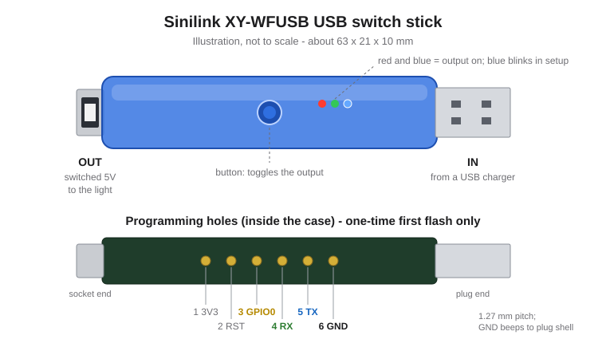

# CameraProbe Relay Firmware

ESP8266 firmware that exposes `GET /on`, `GET /off`, and `GET /status` over HTTP, so CameraProbe can switch a light (or any USB device) whenever your computer's camera turns on or off. It matches CameraProbe's default config (`onair.local:80`).

## Recommended hardware: Sinilink XY-WFUSB USB switch stick



The **Sinilink XY-WFUSB** is the preferred hardware for CameraProbe:

- **Simple power in, power out.** Plug it into any USB charger and plug your USB light into it. There's no relay wiring, no separate power supply and no screw terminals.
- **Clean thumb-drive packaging.** It's a finished, enclosed stick about 63 × 21 × 10 mm, so you don't need a 3D-printed case.
- **Silent switching.** The output is a MOSFET, not a relay, so nothing clicks while you're on camera.
- **Easy updates.** After a one-time first flash, every firmware update is a `.bin` upload over WiFi at `http://onair.local/update`. The case stays closed.
- **Inexpensive:** roughly $5–11.

**Where to buy** (third-party listings; they change, so search "Sinilink XY-WFUSB" if a link stops working):

- Amazon: [Sinilink XY-WFUSB](https://www.amazon.com/dp/B0HFRWPWRY)
- AliExpress: [Sinilink XY-WFUSB](https://www.aliexpress.us/item/3256812406700205.html)

The stick ships with Sinilink's own app firmware. The **first** install of the CameraProbe firmware is done once through small programming holes inside the case; see [Sinilink XY-WFUSB: first flash](#sinilink-xy-wfusb-first-flash). The Wemos D1 Mini and ESP-01S relay boards remain supported for anyone who already has them.

## Universal firmware (flash, boot, configure, go)

`CameraProbeRelayUniversal/` (version 1.1.2) is one firmware for every supported board. You don't edit a `secrets.h` file, and you never re-flash it to change WiFi. You set the WiFi network, board type and device name from a web page.

**First-time setup**

1. Flash `CameraProbeRelayUniversal.ino`. Use **Generic ESP8285 Module** for the Sinilink, or **Generic ESP8266 Module** for the Wemos D1 Mini and ESP-01S; see [Arduino IDE setup](#arduino-ide-setup).
2. Power the device. With no settings saved yet, it starts an open WiFi network called **ConfigUSBSwitchStick**.
3. Join **ConfigUSBSwitchStick** from a phone or computer. The setup page usually opens by itself; if not, browse to `http://192.168.4.1`.
4. Choose your WiFi network and enter its password. The **relay board** is already set to **Sinilink XY-WFUSB USB switch**; change it only if you're using a Wemos D1 Mini + relay shield, an ESP-01S relay module, or a Custom pin/logic. Keep the device name `onair` unless you also change it in CameraProbe's Preferences.
5. Click **Save and reboot**. The device joins your network. Reconnect your phone or computer to your home WiFi and open `http://onair.local/configure` to confirm. The page has **Relay on / Relay off** test buttons.

**Later**

- **Check or change settings:** `http://onair.local/configure`. The saved WiFi password is never shown. Leave the field blank to keep it.
- **New router or WiFi password:** if the device can't join its saved network within about 30 seconds of power-up, it opens **ConfigUSBSwitchStick** again so you can enter the new details.
- **Power cuts:** if the router is still starting up, the device waits in setup mode. If nobody connects to it within 3 minutes, it restarts and tries the saved network again, so it reconnects by itself once the router is back.
- **Factory reset (no button needed):** plug the device in for about 2 seconds and unplug it, two times. Plug it in a third time and leave it. All settings are erased and it starts **ConfigUSBSwitchStick**. The **Factory reset** button on the setup page does the same.
- **Firmware updates over WiFi:** `http://onair.local/update` accepts a `.bin` file. In the Arduino IDE, export one with **Sketch → Export Compiled Binary**. After the first USB flash, you don't need the programmer again.

The output always starts **off** at power-up. The default board is the Sinilink (GPIO5). The firmware never drives GPIO0 unless the ESP-01S preset is chosen, which matters on the ESP-01S, where GPIO0 must not be held low while it boots.

Security note: **ConfigUSBSwitchStick** is an open network by design, so it's easy for novices. It only appears when the device isn't on your WiFi. On your home network, `/configure` and `/update` have no password, so anyone on that network can change them. That's the same trust level as `/on` and `/off`.

## Sinilink XY-WFUSB: first flash

The stick has an ESP8285 inside. Its factory firmware has no wireless upload and isn't Tasmota, so the **first** install has to go through tiny programming holes inside the case. You only do this once per stick. After that, updates go over WiFi.

**What you need**

- A USB-to-serial adapter that can be set to **3.3V**. The tested one was a CH340G module whose 3V3/5V jumper is set to **3V3**.
- **30 AWG** solid wire (wire-wrap or hookup wire), a fine soldering tip, flux and fine solder.
- A thin flat screwdriver or plastic spudger to open the case.

**1. Open the case**

The two halves are a tight friction fit on six pins, with no screws or glue. Work a thin blade into the seam **next to each pin** and twist gently, keeping the halves parallel so the pins don't snap. The board comes out freely.

**2. Find the programming holes**

There's a single row of six unlabelled holes (1.27 mm pitch, about 0.6–0.7 mm diameter), running between the two USB ends:

```
 FEMALE SOCKET (output)                        MALE PLUG (input)
   [=====]   o    o    o    o    o    o   [=====]
             1    2    3    4    5    6
           3V3  RST GPIO0  RX   TX   GND
```

**Confirm the orientation with a multimeter before soldering:** hole 6 (GND) beeps to the **metal shell of the male USB plug**, and hole 1 doesn't.

Pins and clips proved unreliable on holes this small. Soldering short wires is the dependable method.

**3. Solder four wires (holes 3–6) and connect the adapter**

| Hole | Signal | Suggested colour | Adapter pin |
|---|---|---|---|
| 3 | GPIO0 | yellow | **GND** (only while flashing) |
| 4 | RX | green | **TXD** |
| 5 | TX | blue | **RXD** |
| 6 | GND | black | **GND** |
| 1, 2 | 3V3, RST | none | not connected |

Strip only about 1.5 mm, keep joints small, and check that no neighbouring holes are bridged. Don't connect the adapter's VCC: the stick is powered by its own USB plug.

**4. Flash**

1. Set the adapter's jumper to **3V3** and plug it into the computer.
2. With GPIO0 on GND, plug the Sinilink into a **USB charger**. The blue and green LEDs light, meaning it's in flash mode.
3. Set up the Arduino IDE:
   - **Board: "Generic ESP8285 Module"** (not ESP8266; the ESP8285 needs DOUT flash mode).
   - **Flash Size:** 1MB.
   - **Erase Flash:** All Flash Contents.
   - **Upload Speed:** 115200.
4. Click **Upload**. Don't use the prebuilt release `.bin`, which is built for the ESP-01S.
5. **If it can't connect:** swap the RX/TX wires at the adapter, or plug the Sinilink in while "Connecting…" is showing. The Serial Monitor at **74880 baud** shows `boot mode:(1,…)` when the stick is in flash mode.

**5. Set up**

1. Unplug the stick, disconnect GPIO0 from GND, and plug it in again.
2. Join **ConfigUSBSwitchStick** and set it up as above. **Relay board** is already set to **Sinilink XY-WFUSB USB switch**.
3. The Serial Monitor at **115200 baud** shows the firmware's start-up messages.

**6. Finish**

Clip the wires close to the board, check that nothing is bridged, and snap the case shut, lining the button up with its notch. The leftover solder makes it easy to re-attach wires if a future wireless update ever fails.

**On the stick** (with the Sinilink preset):

- **The button** toggles the output.
- **The red LED** lights while the output is on.
- **The blue LED** follows the switch, on when the output is on and off when it's off. It blinks slowly while in setup mode (**ConfigUSBSwitchStick**).
- **Hardware variants:** some XY-WFUSB units have no red LED. On those, the blue LED is the output indicator. If a unit's output, button or LEDs don't respond with the Sinilink preset, it may use different pins. Use **Custom** to try another output pin, and please report the pinout.
- **The green LED** is kept off.

A stick flashed with firmware 1.0.x and set to **Custom → GPIO5, HIGH** keeps that setting after a WiFi update. Choose **Sinilink XY-WFUSB USB switch** on `/configure` to turn on the button and LEDs.

**Updating the firmware later:** export a `.bin` with **Generic ESP8285 Module** selected (**Sketch → Export Compiled Binary**), or download the Sinilink `.bin` from the release page. Upload it at `http://onair.local/update`. Your settings are kept.

## Flash the prebuilt firmware (no Arduino IDE needed)

Each [release](https://github.com/W9TIM/CameraProbe/releases/latest) includes ready-made files. **Pick the one for your hardware**, because the chips need different builds:

| File | For |
|---|---|
| `CameraProbeRelayUniversal-<version>-Sinilink-ESP8285.bin` | **Sinilink XY-WFUSB** |
| `CameraProbeRelayUniversal-<version>-ESP8266.bin` | Wemos D1 Mini, ESP-01S relay |

Either file can be uploaded over WiFi at `http://onair.local/update` to a device that already runs the universal firmware. For a **first** install, use one of the methods below. For the Sinilink, the first flash needs the programming-hole wiring described in [Sinilink XY-WFUSB: first flash](#sinilink-xy-wfusb-first-flash).

**Before you start, connect the board:**

- **Wemos D1 Mini:** plug it into the computer with a USB data cable. Some cables only carry power.
- **ESP-01S:** take the ESP-01S module off the relay board and plug it into the USB programmer. The module must start in flashing mode: GPIO0 held to GND at power-up. If your programmer has a PROG/UART switch, set it to PROG. If not, connect GPIO0 to GND while you plug it in. When flashing is finished, set the switch back (or remove the jumper) and put the module back on the relay board.
- Both boards use a CH340 USB chip. Current macOS and Windows normally recognize it automatically. If no port appears, install the CH340 driver from the adapter maker.

### Option A: in a web browser (easiest)

Use Chrome or Edge on a Mac or PC. Safari isn't supported.

1. Open [espressif.github.io/esptool-js](https://espressif.github.io/esptool-js/), Espressif's own browser flasher.
2. Leave the baud rate at **115200**, click **Connect**, and pick the board's USB serial port (it usually mentions *CH340* or *usbserial*).
3. *(Optional, first time only)* click **Erase Flash** for a clean start.
4. Under **Program**, set **Flash Address** to `0x0`, choose the downloaded `.bin` file, and click **Program**.
5. When it finishes, unplug and replug the board (for the ESP-01S, back on its relay board), then follow [First-time setup](#recommended-universal-firmware-flash-boot-configure-go).

### Option B: from Terminal or PowerShell (esptool)

```
pip install esptool
esptool --port PORT write-flash 0x0 CameraProbeRelayUniversal-<version>-<board>.bin
```

Replace `PORT` with the board's port: on macOS something like `/dev/cu.usbserial-110` (list them with `ls /dev/cu.*`), on Windows `COM3` or similar (shown in Device Manager → Ports). Older esptool versions use `esptool.py` and `write_flash` instead. Add `erase-flash` as a separate command first if you want a clean start:

```
esptool --port PORT erase-flash
```

### Already running the universal firmware?

You don't need USB again. Open `http://onair.local/update`, choose the new `.bin`, and click **Update**. Your settings are kept.

### For maintainers: making the `.bin` for a release

Export **two** builds, with **Flash Size: 1MB (FS:64KB OTA:~470KB)** for both:

1. **Sinilink:** set **Board: Generic ESP8285 Module**, then **Sketch → Export Compiled Binary**. The file appears under `build/esp8266.esp8266.esp8285/CameraProbeRelayUniversal.ino.bin`. Rename it `CameraProbeRelayUniversal-<version>-Sinilink-ESP8285.bin`.
2. **ESP8266 boards:** set **Board: Generic ESP8266 Module** and export again. The file appears under `build/esp8266.esp8266.generic/CameraProbeRelayUniversal.ino.bin`. Rename it `CameraProbeRelayUniversal-<version>-ESP8266.bin`.
3. Attach both to the GitHub release. The version is `FW_VERSION` at the top of the sketch.

The ESP8266 1MB build also runs on the Wemos D1 Mini's larger 4MB flash. Don't commit the `build/` folder. The `.bin` belongs on the release page, not in the repo.

## Fixed-configuration sketches

The original sketches are still here for anyone who prefers settings compiled into the firmware. Each one targets one board and reads WiFi details from `secrets.h`. Pick the one that matches your board:

| Folder | Hardware | Relay logic |
|---|---|---|
| `CameraProbeRelay/` | Wemos D1 Mini + D1 Mini relay shield (photo and parts links in `Wemos D1 Device/`) | Relay pin `D1`; ON = HIGH, OFF = LOW |
| `CameraProbeRelay8266/` | ESP-01S WiFi relay module (wiring, programmer and datasheet in `ESP8266 Module Device/`) | Relay pin GPIO0; ON = LOW, OFF = HIGH (active-low) |

The rest of this guide applies to both. Wherever it says `CameraProbeRelay.ino`, open the `.ino` in the folder you chose (`CameraProbeRelay8266.ino` for the ESP-01S).

## Hardware

- **Wemos D1 Mini variant:** a Wemos D1 Mini with a relay shield (or an LED for testing) on `D1`. Edit `relayPin` in the sketch if you wire it elsewhere.
- **ESP-01S relay variant:** an ESP-01S relay module, programmed through a USB-to-ESP-01 adapter (CH340G). The relay is on GPIO0. On a 2-relay board the second relay is on GPIO2.
- Power the relay module's VCC/GND per its datasheet. Most 5V relay modules run fine off the board's 5V/VIN pin for light use; use a separate 5V supply if the relay is switching anything with real current draw.

## Single-supply wiring (ESP-01S relay variant)

The ESP-01S relay module can run the board and the switched device from one 5V USB supply, using two USB-A pigtails:

- **Male USB-A pigtail** - the power *input*, plugged into any 5V USB supply.
- **Female USB-A pigtail** - the switched *output*; plug the light or other 5V USB device into it.

| Connection | Wired to |
|---|---|
| Board power input **+5V (VCC)** | Male pigtail **+5V** and Female pigtail **+5V** (both on the same terminal) |
| Board power input **GND** | Male pigtail **GND**, plus a jumper to the relay **COM** |
| Relay **COM** | Jumper to board power GND (above) |
| Relay **NO** (Normally Open) | Female pigtail **GND** |
| Relay **NC** (Normally Closed) | Not connected |

```
 USB supply --> Male pigtail
                  +5V ---+---------------- Board VCC ---- Female pigtail +5V
                         |
                  GND ---+-- Board GND
                            |
                            +-- jumper --> Relay COM
                                           Relay NO  --> Female pigtail GND
                                           Relay NC  --> (unused)
```


*Example of the finished wiring. The photo is upside down compared with the manufacturer's diagram in `ESP8266 Module Device/`, so the relay block is on the left and the power block is in the middle. The white jumper runs from the relay **COM** (middle terminal) to the power block **GND**. The black wire in the relay block is the **NO** terminal, which goes to the female pigtail GND. The red wires, both on the power block **VCC**, are the male and female pigtail +5V. The other black wire on the power block is the male pigtail GND.*

How it works: +5V is always present on the output pigtail, and the relay switches only the **ground** leg. With the relay off, NO is open, so the device has no return path and stays off. When CameraProbe turns the relay on, COM connects to NO, the circuit completes, and the light comes on.

Limits: the output can't exceed what your USB supply, the pigtail wire gauge and the relay module's terminals can safely carry. The 10A figure is the relay contact rating, not a promise for the whole path. Use a supply and wire sized for your actual load, and for a typical USB light this is far more than needed.

## Arduino IDE setup

1. Install the [Arduino IDE](https://www.arduino.cc/en/software) if you don't already have it.
2. Add the ESP8266 board package: **Arduino IDE → Settings → Additional boards manager URLs**, add:
   ```
   https://arduino.esp8266.com/stable/package_esp8266com_index.json
   ```
3. **Tools → Board → Boards Manager**, search "esp8266", install it.
4. **Tools → Board**, select **"Generic ESP8266 Module"** for the universal firmware (either board), or for the fixed sketches **"LOLIN(WEMOS) D1 R2 & mini"** (Wemos D1 Mini) / **"Generic ESP8266 Module"** (ESP-01S). For the universal firmware, also set **Tools → Flash Size** to an option with an OTA area, such as **"1MB (FS:64KB OTA:~470KB)"**, so `/update` works.
5. No extra libraries to install - `ESP8266WiFi`, `ESP8266mDNS`, and `ESP8266WebServer` all ship with the board package.

## Configure and flash (fixed-configuration sketches)

For the universal firmware, just open `CameraProbeRelayUniversal/CameraProbeRelayUniversal.ino`, upload it, and follow [First-time setup](#recommended-universal-firmware-flash-boot-configure-go) above. Skip steps 2–3 below, since there's no `secrets.h`.

1. Open `CameraProbeRelay.ino` in the Arduino IDE.
2. In this same folder, copy `secrets.h.example` to `secrets.h` and fill in your real WiFi network name and password:
   ```
   cp secrets.h.example secrets.h
   ```
   `secrets.h` is gitignored, so it's never committed - your WiFi password stays off GitHub even though this repo is public.
3. If you're wiring the relay to a different pin, or want a different mDNS hostname than `onair`, edit `relayPin` / the `MDNS.begin("onair")` call near the top of the sketch (and update `relay.host` in `config.json` to match).
4. Plug in the board, select the correct port under **Tools → Port**, and click **Upload**.
5. Open the Serial Monitor (115200 baud) to confirm it connects to WiFi and starts the mDNS responder - it prints its IP address once connected.

## Verify

From any machine on the same network:

```
curl http://onair.local/on
curl http://onair.local/off
curl http://onair.local/status
```

`/on` and `/off` return `Relay ON` / `Relay OFF` and the relay should click; `/status` reports the current state (`ON` or `OFF`) without changing it. This matches exactly what CameraProbe's `relay.host` / `relay.port` config expects - with the default hostname, no config changes are needed on the Mac side.
